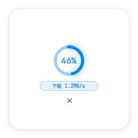
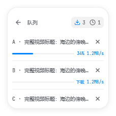
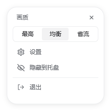
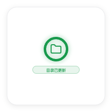

<h1 align="center"> Ameow</h1>

Your little desktop download cat. Just paste a link.

  
  
  
  
  
  

 

## Paste a link, leave it to the cat

Paste a public media link and download up to three items at once. If one fails, give it another try.

  

 

## Quality and save folder are up to you

Choose a quality preset and drop a folder onto the window to set your save location.

   &emsp;
  

---

[User manual](https://wutpeach.github.io/Ameow/en/docs/) · [CLI](site/src/content/docs/en/docs/cli.md) · [简体中文](README.md) · [Third-party notices](THIRD_PARTY_NOTICES.md)
