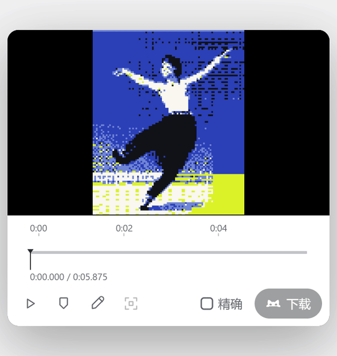

<h1 align="center"> Ameow</h1>

Your little desktop download cat. Just paste a link.

  
  
  
  
  
  

Clips and browser session sync preview a future version; the current **0.5.0** release does not include them. The GIFs use isolated example states.

## Your desktop cat

The cat waits quietly on your desktop. Move closer to expand it, then move away to tuck it back in.

  

## Paste a link

Paste a media link and let the cat take over. Follow its progress in the floating window.

  

## Keep the part you want

Mark a section on the video page and send it to the cat. Fast cuts may start or end near a keyframe.

  

## Browser session sync

Configure the browser connection in Ameow and copy the extension folder path. On the extensions page in the same Chrome or Edge browser, enable developer mode, load the unpacked extension, paste the path and select the folder.

Then open the extension on a webpage, confirm the site scope and authorize it to sync the existing session for downloads. Sync does not sign you in or guarantee that the site still accepts the session.

  

## Development and building

See [Contributing](CONTRIBUTING.md) for setup and build instructions. Scripts and agents can use ameow-cli to work with the same desktop queue; see the [CLI user guide](https://github.com/Wutpeach/Ameow/blob/2c916bc78a593cae3e5cc2f8961cb07374002def/site/src/content/docs/en/docs/cli.md) (development candidate; CLI is not included in the 0.5.0 release).

---

[User manual](https://wutpeach.github.io/Ameow/en/docs/) · [简体中文](README.md) · [Third-party notices](THIRD_PARTY_NOTICES.md) · [GIF sources](docs/images/readme/README.md)
