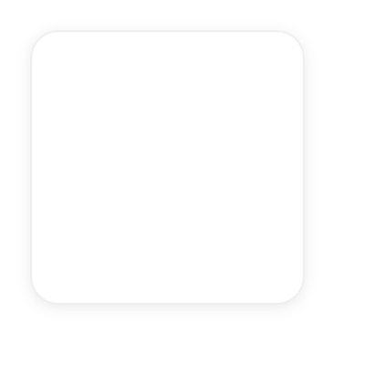

<h1 align="center"> Ameow</h1>

Your little desktop download cat. Just paste a link.

Ameow is a desktop media downloader for editors and content creators. Collect videos, images and galleries, mark clips on supported video pages, and reuse browser sessions you authorize. Follow progress, manage the queue and check saved results from the floating window.

  <a href="https://github.com/Wutpeach/Ameow/releases/latest"><strong>Download Ameow</strong></a> ·
  <a href="https://wutpeach.github.io/Ameow/en/docs/"><strong>User manual</strong></a> ·
  <a href="README.md">简体中文</a>

  
  
  
  
  
  

## What you can do

- **Collect media links:** resolve video, image and gallery links and save results to your chosen folder.
- **Download a clip:** use Peek and Marker on supported video pages to select the part you want.
- **Manage progress and quality:** follow the queue, cancel tasks, retry failures, and choose Highest, Balanced or Data saver.
- **Use a browser or scripts:** the optional extension adds page tools and session sync; the CLI shares the desktop queue.

Check the [yt-dlp site list](https://github.com/yt-dlp/yt-dlp/blob/master/supportedsites.md) for video and the [gallery-dl site list](https://github.com/mikf/gallery-dl/blob/master/docs/supportedsites.md) for images and galleries. Websites change; actual support depends on whether the link can be resolved and downloaded.

## Download and get started

| System | Package to choose |
| --- | --- |
| Windows x64 | [Installer or portable ZIP](https://github.com/Wutpeach/Ameow/releases/latest) |
| Apple Silicon Mac, macOS 13 or later | [Mac ZIP](https://github.com/Wutpeach/Ameow/releases/latest) |

No Intel Mac or Linux build is provided.

1. **Install and open.** Launch the Windows installer build from Start. For the portable build, extract everything and run `AmeowLauncher.exe`. On Mac, move `Ameow.app` to `/Applications` or `~/Applications` and open it from Finder.
2. **Choose a save folder.** Select a writable folder in Settings, or drop a folder onto the floating window. Follow the prompts to prepare download components online on first use.
3. **Paste a media link.** Paste into the floating window and follow progress in the queue. Collect the files from your save folder when the task finishes.

See the [installation guide](https://wutpeach.github.io/Ameow/en/docs/downloads/) and [user manual](https://wutpeach.github.io/Ameow/en/docs/) for detailed steps.

The following GIFs demonstrate the interface with example data.

## Your desktop cat

Move closer to the desktop cat to expand the floating window, paste a link or check tasks, then move away to tuck it back in. Keep the cat nearby and expand the controls when you need them.

  

## Paste a link

Copy a media link and paste it into the floating window. Up to three tasks run at once while the rest wait. Follow progress, cancel a task or retry a failure in the queue. Completed files go to the folder chosen when the task was submitted.

  

## Keep the part you want

With the extension loaded, use Peek and Marker on a YouTube or Bilibili page playing a single on-demand video to adjust a clip range, then send it to the cat. Fast cuts may start or end near a keyframe.

  

## Browser session sync

Page tools and session sync require the Chrome/Edge extension (Chromium 120 or later). Choose Set up extension in Settings, use the path and demo on that page to load it, then confirm the site scope and authorize it from the webpage.

Sync reuses the browser session you already have. It does not sign you in or verify that the site still accepts the session. The Page tools switch and site-session permission are independent.

  

## Frequently asked questions

**Do ordinary downloads require the extension or a login?**

No. You can try a regular link without a browser session. Load the extension when you want video-page clip tools or to reuse a session, and grant permission for the feature you need.

**Why do some links fail?**

Changes to a site, permissions, the network or download components can affect results. Start with the queue's error message, then retry or copy diagnostics as directed. See [troubleshooting](https://wutpeach.github.io/Ameow/en/docs/troubleshooting/) for specific steps.

**Where are my downloaded files?**

First check that the task has finished, including post-processing. Files go to the folder chosen when the task was submitted; changing the save folder affects new tasks. Double-click an empty area of the floating window to open the confirmed folder. See [save folders](https://wutpeach.github.io/Ameow/en/docs/desktop/output-folder/).

**Why is there no Mac Dock icon?**

Ameow runs from the menu bar by default. Use the cat icon there to open the app or Settings. Closing Settings does not quit the app.

## Development and contributing

Scripts and agents can use `ameow-cli` to submit tasks, query progress and wait for results in the same desktop queue. See the [CLI user guide](https://wutpeach.github.io/Ameow/en/docs/cli/) for installation and commands.

See [Contributing](CONTRIBUTING.md) for setup, builds and tests. Report problems or suggestions in [Issues](https://github.com/Wutpeach/Ameow/issues), with reproduction steps and diagnostics you have checked before sharing.

## License

Application code is licensed under [MIT](LICENSE). Third-party dependencies, download components and assets follow their own notices; see [Third-party notices](THIRD_PARTY_NOTICES.md).

---

[User manual](https://wutpeach.github.io/Ameow/en/docs/) · [Changelog](https://github.com/Wutpeach/Ameow/releases) · [简体中文](README.md) · [GIF sources](docs/images/readme/README.md)
