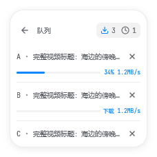

<h1 align="center"> Ameow</h1>

桌面上的下载小猫，贴个链接就开工。

  
  
  
  
  
  

 

## 贴个链接，交给小猫

粘贴公开媒体链接，最多三个任务一起下载。失败了，点一下再试。

  

 

## 画质和落点，都由你

按需选画质，拖入文件夹设置保存位置。

   &emsp;
  

---

[使用手册](https://wutpeach.github.io/Ameow/docs/) · [CLI](site/src/content/docs/docs/cli.md) · [English](README.en.md) · [第三方说明](THIRD_PARTY_NOTICES.md)
