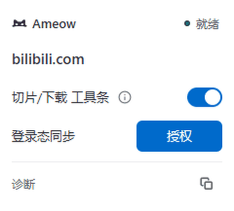

<h1 align="center"> Ameow</h1>

桌面上的下载小猫，贴个链接就开工。

Ameow 是面向后期和内容创作者的桌面素材下载工具。采集视频、图片与图集，在支持的视频页面圈选片段，也可复用自己授权的浏览器会话。下载进度、队列和保存结果都在桌面浮窗里查看。

  <a href="https://github.com/Wutpeach/Ameow/releases/latest"><strong>下载 Ameow</strong></a> ·
  <a href="https://wutpeach.github.io/Ameow/docs/"><strong>使用手册</strong></a> ·
  <a href="README.en.md">English</a>

  
  
  
  
  
  

## 能做什么

- **链接采集**：解析视频、图片与图集链接，将结果保存到指定目录。
- **片段下载**：在支持的视频页面，用 Peek 和 Marker 选出需要的一段。
- **队列与画质**：查看进度、取消任务、重试失败项，选择最高、均衡或省流量。
- **浏览器与脚本**：可选扩展提供页面工具和登录态同步；CLI 与桌面共用同一队列。

视频站点可查 [yt-dlp 支持列表](https://github.com/yt-dlp/yt-dlp/blob/master/supportedsites.md)，图片与图集可查 [gallery-dl 支持列表](https://github.com/mikf/gallery-dl/blob/master/docs/supportedsites.md)。站点会变化，最终以实际解析与下载结果为准。

## 下载与上手

| 系统 | 选择的下载包 |
| --- | --- |
| Windows x64 | [安装程序或便携 ZIP](https://github.com/Wutpeach/Ameow/releases/latest) |
| Apple Silicon Mac，macOS 13 或更新 | [Mac ZIP](https://github.com/Wutpeach/Ameow/releases/latest) |

Intel Mac 和 Linux 没有对应构建。

1. **安装并打开。** Windows 安装版从开始菜单启动；便携版完整解压后运行 `AmeowLauncher.exe`。Mac 将 `Ameow.app` 移入 `/Applications` 或 `~/Applications`，从 Finder 打开。
2. **选好保存位置。** 在设置中选择可写文件夹，也可把文件夹拖入浮窗。首次使用按提示联网准备下载组件。
3. **粘贴媒体链接。** 在浮窗粘贴链接，打开队列查看进度；完成后到保存目录取文件。

详细步骤见[安装指南](https://wutpeach.github.io/Ameow/docs/downloads/)和[使用手册](https://wutpeach.github.io/Ameow/docs/)。

以下动图使用示例数据演示界面。

## 桌面小猫

需要下载时，靠近桌面小猫展开浮窗，粘贴链接或查看任务；离开后收回。空闲时保留小猫，需要操作时再展开。

  

## 粘贴链接

复制媒体链接，在浮窗粘贴。队列最多同时执行三个任务，其余等待；可查看进度、取消任务或重试失败项。完成的文件保存在任务提交时选定的目录。

  

## 切片功能

加载扩展后，在 YouTube 或 Bilibili 的单作品点播页面，用 Peek 和 Marker 调整片段选区，再交给小猫。默认快速粗切，实际边界可能落在关键帧附近；开启「精确」会重新编码，耗时更长。同一作品重新打开保留选择，换作品重置。

  

## 登录态同步

页面工具与登录态同步需要 Chrome/Edge 扩展（Chromium 120 或更新）。在设置中点击“配置扩展”，按同页路径与演示加载扩展，再在网页中确认站点范围并授权。

同步复用浏览器已有会话，不会替你登录，也不验证网站是否仍接受该会话。页面工具开关与站点会话授权彼此独立。

  

## 常见问题

**普通下载必须装扩展或登录吗？**

不需要。普通链接可直接匿名尝试下载；需要视频页面上的片段工具，或希望复用已有登录态时，再加载扩展并按用途授权。

**为什么有些链接下载失败？**

站点、权限、网络或下载组件变化都可能影响结果。先看队列中的错误提示，按提示重试或复制诊断；具体处理见[排查问题](https://wutpeach.github.io/Ameow/docs/troubleshooting/)。

**下载的文件在哪里？**

先确认任务已完成，后处理未结束时继续等待。文件写入任务提交时的目录；之后更改保存位置只影响新任务。可双击浮窗空白处打开已确认目录，详见[保存位置](https://wutpeach.github.io/Ameow/docs/desktop/output-folder/)。

**Mac 为什么没有 Dock 图标？**

Ameow 默认从菜单栏运行。点击菜单栏猫咪图标打开应用或设置；关闭设置窗口不会退出应用。

## 开发与贡献

脚本与 Agent 可通过 `ameow-cli` 提交任务、查询进度和等待结果，与桌面共用同一队列；安装和命令见 [CLI 用户指南](https://wutpeach.github.io/Ameow/docs/cli/)。

开发环境、构建与测试见[贡献指南](CONTRIBUTING.md)。问题和建议可提交到 [Issues](https://github.com/Wutpeach/Ameow/issues)，附上复现步骤和经过检查的诊断信息。

## 许可

应用代码采用 [MIT 许可](LICENSE)。第三方依赖、下载组件和素材遵循各自声明，见[第三方说明](THIRD_PARTY_NOTICES.md)。

---

[使用手册](https://wutpeach.github.io/Ameow/docs/) · [更新记录](https://github.com/Wutpeach/Ameow/releases) · [English](README.en.md) · [动图来源](docs/images/readme/README.md)
