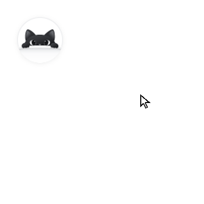
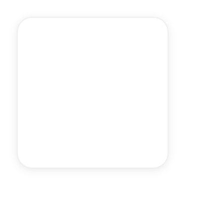
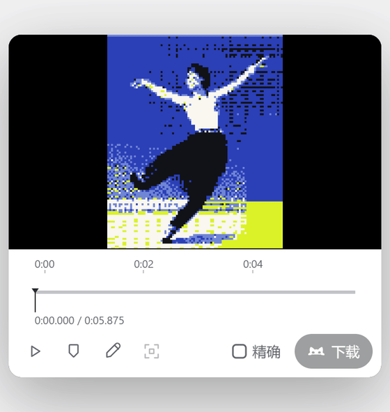

<h1 align="center"> Ameow</h1>

桌面上的下载小猫，贴个链接就开工。

  
  
  
  
  
  

切片与登录态同步为后续版本预览，正式 **0.5.0** 尚未包含。以下动图为隔离示例演示。

## 桌面小猫

小猫安静地待在桌面，靠近时展开，用完再收回。

  

## 粘贴链接

粘贴媒体链接，小猫接过下载任务。在浮窗里查看进度。

  

## 切片功能

在视频页面标出需要的一段，再交给小猫。采用快速粗切，实际边界可能落在关键帧附近。

  

## 登录态同步

从扩展主动授权一个站点，同步浏览器已有会话，供之后的下载复用。同步不会替你登录。

  

## 开发与构建

开发环境和构建步骤见[贡献指南](CONTRIBUTING.md)。脚本与 Agent 可通过 ameow-cli 操作同一桌面队列，详见[CLI 用户指南](https://github.com/Wutpeach/Ameow/blob/2c916bc78a593cae3e5cc2f8961cb07374002def/site/src/content/docs/docs/cli.md)（开发候选；正式 0.5.0 尚不含 CLI）。

---

[使用手册](https://wutpeach.github.io/Ameow/docs/) · [English](README.en.md) · [第三方说明](THIRD_PARTY_NOTICES.md) · [动图来源](docs/images/readme/README.md)
